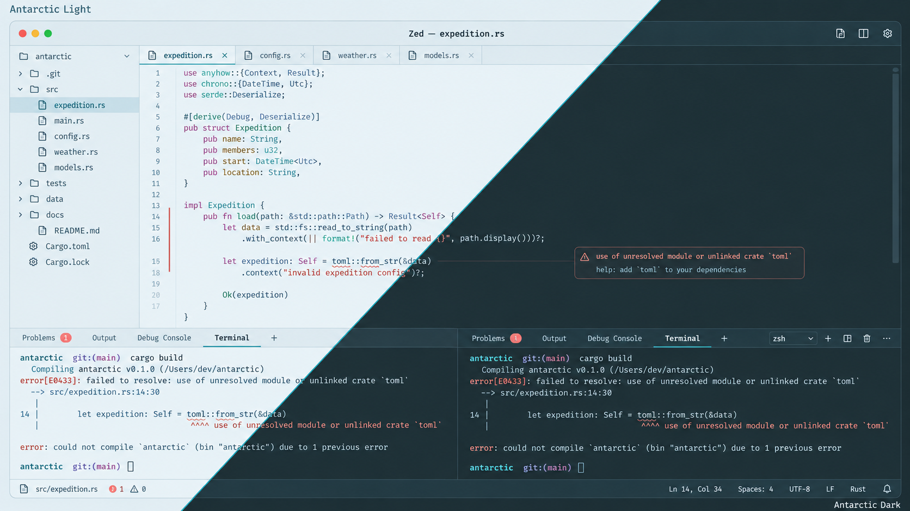

# Antarctic for Zed

Light and dark themes based on the shared [Antarctic palette](https://github.com/AntarcticTheme/.github/blob/main/profile/README.md).



## Requirements

Install [Zed](https://zed.dev/download). The theme is one JSON file containing both variants.

## Install

Download the theme family, which contains **Antarctic Light** and **Antarctic Dark**:

```sh
mkdir -p "$HOME/.config/zed/themes"
curl -fL https://raw.githubusercontent.com/AntarcticTheme/Zed/main/themes/antarctic.json -o "$HOME/.config/zed/themes/antarctic.json"
```

On Windows, create the destination directory if necessary, then download the same files using the GitHub raw-file download button and copy `themes/antarctic.json` into `%APPDATA%\Zed\themes`.

Restart Zed, open the theme selector, and choose a variant. To follow system appearance, merge this into your Zed settings:

```json
{
  "theme": {
    "mode": "system",
    "light": "Antarctic Light",
    "dark": "Antarctic Dark"
  }
}
```

Includes UI, syntax, diagnostics, Git status, collaboration colors, and terminal ANSI colors. This is a local theme family; it does not require a marketplace extension.

## Updates

To update, repeat the download/copy steps, then restart the application or reload its configuration.

Released under the MIT license. See [LICENSE](LICENSE).
